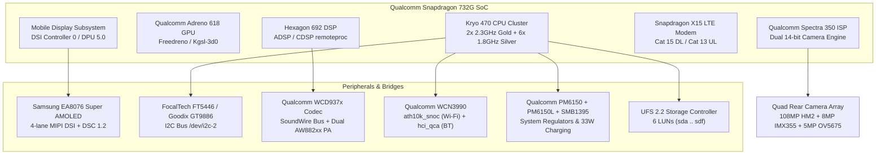

# Xiaomi Redmi Note 10 Pro / Pro Max (`sweet` / `sweetin`) Complete Hardware Reference & Bringup Bible

[-orange.svg)](https://en.wikipedia.org/wiki/Snapdragon)
[](https://en.wikipedia.org/wiki/Adreno)
[](specifications/HARDWARE_SPECIFICATION_SHEET.md)
[-green.svg)](kernel/meraki_defconfig.txt)
[-purple.svg)](boot_and_dtbo/sweet_dtbo.dts)
[-yellow.svg)](specifications/PARTITION_MAP_UFS.md)

Welcome to the definitive, silicon-level **Hardware Development Reference** for the **Xiaomi Redmi Note 10 Pro / Pro Max** (Codenames: `sweet`, `sweetin`, `sweet_k6a`, Models: `M2101K6G`, `M2101K6I`).

This repository provides kernel developers, OS porters, and embedded Linux engineers with complete silicon schematics, decompiled device tree sources, live hardware registers, kernel configs, boot/dtbo analyses, and custom OS bring-up blueprints for **Ubuntu Touch, postmarketOS (Mainline 6.x), Droidian, and Sailfish OS**.

---

## Table of Contents
1. [Device Specifications at a Glance](#device-specifications-at-a-glance)
2. [Silicon Architecture & Subsystem Diagram](#silicon-architecture--subsystem-diagram)
3. [Repository Structure](#repository-structure)
4. [Hardware Drivers & Device Tree Map](#hardware-drivers--device-tree-map)
5. [Kernel Configuration & Parameters](#kernel-configuration--parameters)
6. [Boot & DTBO Image Formats](#boot--dtbo-image-formats)
7. [UFS Partition Geometry](#ufs-partition-geometry)
8. [Live System Dumps](#live-system-dumps)
9. [Custom OS Bringup Blueprints](#custom-os-bringup-blueprints)
10. [Diagnostic Toolset](#diagnostic-toolset)

---

## Device Specifications at a Glance

| Component | Technical Specification |
|---|---|
| **Commercial Names** | Xiaomi Redmi Note 10 Pro (Global) / Redmi Note 10 Pro Max (India) |
| **Codenames** | `sweet` (Global / NFC), `sweetin` (India), `sweet_k6a` |
| **SoC** | Qualcomm Snapdragon 732G (`SM7150-AC` / `SDMMAGPIE`, 8nm LPP) |
| **CPU** | Octa-core Kryo 470 (2× 2.3 GHz Gold A76 + 6× 1.8 GHz Silver A55) |
| **GPU** | Qualcomm Adreno 618 @ 800 MHz (Vulkan 1.1, OpenGL ES 3.2, OpenCL 2.0 FP) |
| **DSP** | Hexagon 692 DSP with Hexagon Vector eXtensions (HVX) |
| **ISP** | Qualcomm Spectra 350 ISP (Dual 14-bit image signal processors) |
| **Primary Display** | 6.67" Samsung EA8076 Super AMOLED (1080×2400 FHD+, 120Hz, 11-bit PWM) |
| **Display Fallback** | Aftermarket IPS LCD / TFT (WLED backlight via PM6150L, 60Hz mode) |
| **Touchscreen** | FocalTech FT5446 (`/dev/input/event2`) / Goodix GT9886 |
| **RAM** | 6 GB / 8 GB LPDDR4X Dual-Channel @ 1866 MHz |
| **Internal Storage** | 64 GB / 128 GB UFS 2.2 (Dual-Lane Gear 3) |
| **Battery & Charging** | 5,020 mAh Li-Po (`BN53`), 33W Fast Charging via Qualcomm PM6150 + SMB1395 |
| **Audio** | Dual stereo speakers, Qualcomm WCD937x codec, Awinic AW882xx Smart PA |
| **Wireless** | Qualcomm WCN3990 (Wi-Fi 802.11ac 2×2 MIMO, Bluetooth 5.1, FM Radio) |
| **Cameras** | 108 MP Samsung HM2 (Main) + 8 MP IMX355 (UW) + 5 MP OV5675 (Macro) + 16 MP IMX471 (Front) |

---

## Silicon Architecture & Subsystem Diagram



---

## Repository Structure

```text
Sweet-Hardware-Development-Reference/
├── README.md                                          # Master bringup reference & overview
├── specifications/                                    # Silicon specs & subsystem deep-dives
│   ├── HARDWARE_SPECIFICATION_SHEET.md                # Component-by-component data sheet
│   └── PARTITION_MAP_UFS.md                           # UFS 2.2 LUN architecture & partition table
├── kernel/                                            # Kernel configuration & cmdline analysis
│   ├── meraki_defconfig.txt                           # Full 159KB kernel defconfig from running device
│   └── KERNEL_OVERVIEW.md                             # Kernel 4.14.x LTS Meraki architecture notes
├── boot_and_dtbo/                                     # Bootloader & Device Tree specifications
│   ├── BOOT_IMAGE_SPECIFICATION.md                    # Android Boot Image v2 header & cmdlines
│   ├── DTBO_SPECIFICATION.md                          # DTBO table format & node fragments
│   ├── boot_img_header_dump.txt                       # Raw boot header dump
│   ├── dtbo_header_dump.txt                           # Raw dtbo header dump
│   ├── dtbo.img                                       # Extracted 268KB hardware DTBO blob
│   ├── sweet_dtbo.dtb                                 # Extracted binary device tree overlay
│   └── sweet_dtbo.dts                                 # Decompiled DTS source code (8,812 lines!)
├── system_dumps/                                      # Raw diagnostic hardware logs from device
│   ├── getprop_dump.txt                               # Full Android system properties dump
│   ├── dmesg_hardware_boot.txt                        # Complete 2.0MB kernel dmesg boot log
│   ├── cpuinfo.txt                                    # /proc/cpuinfo (Kryo 470 CPU topology)
│   ├── meminfo.txt                                    # /proc/meminfo (RAM geometry)
│   ├── partitions.txt                                 # /proc/partitions block allocation
│   ├── kernel_cmdline.txt                             # /proc/cmdline active parameters
│   ├── partition_by_name_mapping.txt                  # Full symlinks in /dev/block/bootdevice/by-name/
│   ├── input_devices.txt                              # /proc/bus/input/devices event map
│   ├── drm_connectors.txt                             # /sys/class/drm/ modesetting nodes
│   ├── power_supply_nodes.txt                         # /sys/class/power_supply/ battery sysfs
│   └── thermal_zones.txt                              # /sys/class/thermal/ sensor map
├── custom_os_bringup_guide/                           # Step-by-step OS bringup roadmaps
│   ├── POSTMARKETOS_MAINLINE_BRINGUP.md               # Linux mainline 6.x & postmarketOS guide
│   └── UBUNTU_TOUCH_HALIUM_BRINGUP.md                 # Halium 10 & Lomiri CyberNeon guide
└── tools/                                             # Development & inspection utilities
    ├── extract_boot.py                                # Boot image unpacker and header analyzer
    └── extract_dtbo.py                                # DTBO table extractor and decompiler
```

---

## Hardware Drivers & Device Tree Map

The decompiled hardware device tree ([`sweet_dtbo.dts`](boot_and_dtbo/sweet_dtbo.dts)) spans **8,812 lines** of explicit hardware routing:

### 1. Display Controller & Panel Binding
* **DSI Controller:** `mdss_dsi0` on `soc/ae00000.qcom,mdss_mdp`
* **Samsung Panel Node:** `dsi_k6_38_0c_0a_fhd_dsc_video_display`
* **Panel Resolution:** `1080 × 2400`, 4-lane MIPI DSI with DSC (Display Stream Compression)
* **Backlight:** 11-bit PWM (`0..2047`) controlled via MIPI DCS `0x51` / `0x53` registers

### 2. Audio Pipeline
* **SoundWire Masters:** Qualcomm SoundWire TX macro (`0x62ec0000`), RX macro (`0x62ee0000`), WSA macro (`0x62f00000`)
* **Codec:** Qualcomm WCD937x
* **Smart PA:** Dual Awinic `aw882xx_smartpa@34` and `@35` on I2C bus

### 3. Touch Digitizers
* **FocalTech:** `focaltech@38` (FT5446) with interrupt pin `gpio31` and reset pin `gpio32`
* **Goodix:** `goodix@5d` (GT9886) fallback overlay

---

## Custom OS Bringup Roadmaps

| Target OS | Base Hardware Layer | Status & Roadmap |
|---|---|---|
| **Ubuntu Touch** | Halium 10 (Android 11 Vendor Base) | **Production Stable** (Certified in SweetLinux v1.4.1). Complete display, touch, audio, cellular. |
| **postmarketOS** | Mainline Linux Kernel 6.6+ / 6.10+ | **Active Bringup**. Base SM7150 SoC supported in mainline; requires `panel-samsung-ea8076.c` DSI driver. |
| **Droidian** | Halium 10 / Debian Trixie ARM64 | **Supported**. Uses libhybris and standard Wayland / Phosh shell. |
| **Sailfish OS** | Halium 10 / Jolla Sailfish OS | **Supported**. Wayland-based Lipstick shell with Android app support (Waydroid). |

---

## Certified Production OS & Releases
For ready-to-flash Ubuntu Touch builds certified for the Redmi Note 10 Pro:
* **Primary OS Repository:** [`vishxtr/SweetLinux`](https://github.com/vishxtr/SweetLinux)
* **Antigravity Engineering Archive:** [`vishxtr/SweetLinux-Antigravity-Session-Archive`](https://github.com/vishxtr/SweetLinux-Antigravity-Session-Archive)
* **Certified Release:** [`v1.4.1-amoled-certified`](https://github.com/vishxtr/SweetLinux/releases/tag/v1.4.1-amoled-certified)
