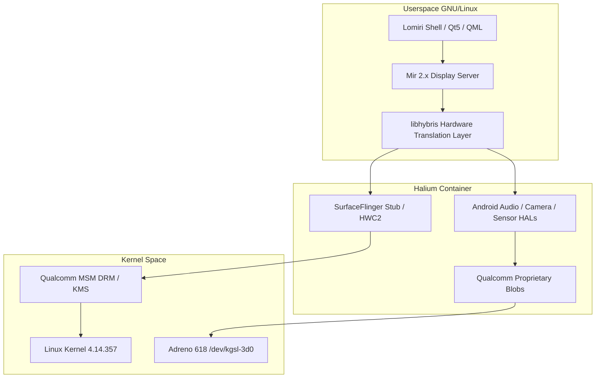

# Ubuntu Touch & Halium 10 Bringup Guide for Xiaomi Redmi Note 10 Pro (`sweet`)

## 1. Architectural Architecture

Ubuntu Touch on `sweet` relies on **Halium 10** (Android 11 vendor base) with the **Lomiri CyberNeon** environment.



---

## 2. Display Pipeline & Resiliency Checklist

1. **Purge Virtual Framebuffers:**
   Do NOT use `video=vfb:enable` or `console=tty0` in `data/boot.img`. Mir must acquire exclusive master access to `/dev/dri/card0`.
2. **Bind Panel Timing Directly:**
   Append `msm_drm.dsi_display0=dsi_k6_38_0c_0a_fhd_dsc_video_display:` to the kernel cmdline.
3. **Adaptive Hardware Probing:**
   Probe `/sys/class/backlight/panel0-backlight` (AMOLED, 11-bit PWM `0..2047`) vs `/sys/class/leds/lcd-backlight` (LCD, 8-bit PWM `0..255`) dynamically at early boot in `/usr/share/halium-overlay/system/bin/ubports.sh`.
4. **Mir Display Configuration (`/etc/mirplatform/mir.display.conf`):**
   ```text
   [device-default]
   compositor-mode=gbm
   display-mode=1080x2400@120
   ```

---

## 3. Recovery Packaging Standard (The Entry #0 Rule)

Due to 32-bit seek limitations in TWRP and OrangeFox:
1. `tools/busybox` or `update-binary` MUST begin at byte offset `0` (Entry #0).
2. Large payloads (`system.img` or `ubuntu.img` ~2GB - 3GB) must be placed at the end of the ZIP archive.
3. Do NOT compress `system.img` with ZIP64 extensions in recovery installers unless the target recovery explicitly links a 64-bit `minizip`.
