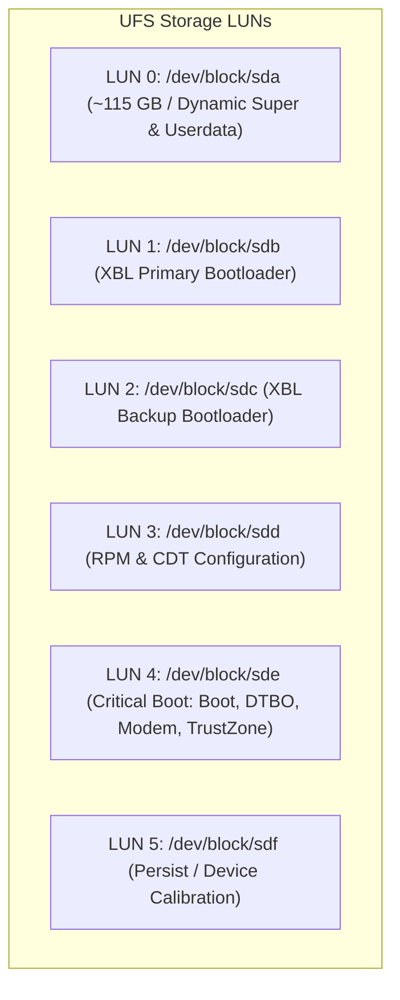

# Xiaomi Redmi Note 10 Pro / Pro Max (`sweet` / `sweetin`) UFS Partition Layout

## 1. Storage Architecture Overview
The Redmi Note 10 Pro features a **UFS 2.2** dual-lane flash storage subsystem partitioned into six physical LUNs (`sda`, `sdb`, `sdc`, `sdd`, `sde`, `sdf`).

---

## 2. Master Partition Map & Purpose

| Partition Name | Block Device Node | Size | Filesystem / Type | Purpose & Bringup Notes |
|---|---|---|---|---|
| **`boot`** | `/dev/block/sde49` | 128 MB | Android Boot Image v2 | Contains kernel Image.gz + initramfs. Crucial for custom OS bringup. |
| **`dtbo`** | `/dev/block/sde45` | 32 MB | Device Tree Blob Overlay | Contains runtime DT overlays for display, touch, sound, camera. |
| **`super`** | `/dev/block/sda25` | 9.0 GB | Android Dynamic Partitions (LP) | Contains `system`, `vendor`, `product`, `system_ext`, and `odm` sub-partitions. |
| **`userdata`** | `/dev/block/sda34` | ~105 GB | F2FS / ext4 | Primary user data and rootfs mount point for SweetLinux / Ubuntu Touch. |
| **`recovery`** | `/dev/block/sda30` | 128 MB | Android Boot Image v2 | Recovery partition (TWRP / OrangeFox / Lineage Recovery). |
| **`persist`** | `/dev/block/sdf7` | 64 MB | ext4 | Factory Wi-Fi MAC, Bluetooth address, camera calibration, fingerprint sensors. **NEVER WIPE.** |
| **`modem`** | `/dev/block/sde52` | 320 MB | vfat / FAT16 | Qualcomm cellular baseband firmware (`NON-HLOS.bin`). |
| **`dsp`** | `/dev/block/sde48` | 64 MB | ext4 | Hexagon DSP firmware (`ADSP`, `CDSP`). Required for camera & sensors. |
| **`bluetooth`** | `/dev/block/sde27` | 64 MB | ext4 | WCN3990 Bluetooth firmware (`bt_firmware`). |
| **`vbmeta`** | `/dev/block/sde10` | 8 KB | Android Verified Boot 2.0 | Cryptographic hashes for boot/dtbo/recovery verification. |
| **`vbmeta_system`**| `/dev/block/sde12` | 8 KB | AVB 2.0 | AVB hash descriptor for system dynamic partition. |
| **`vbmeta_vendor`**| `/dev/block/sde13` | 8 KB | AVB 2.0 | AVB hash descriptor for vendor dynamic partition. |
| **`splash`** | `/dev/block/sda23` | 64 MB | Raw RGB565 / BMP | OEM boot splash logo shown before kernel boots. |
| **`xbl`** | `/dev/block/sdb2` | 4 MB | Qualcomm ELF | eXtensible BootLoader (PBL -> XBL). First-stage userspace bootloader. |
| **`abl`** | `/dev/block/sde36` | 2 MB | Qualcomm ELF | Android BootLoader (Fastboot interface & kernel loader). |
| **`tz`** | `/dev/block/sde38` | 4 MB | Qualcomm ELF | Qualcomm TrustZone secure monitor (QSEE). |
| **`metadata`** | `/dev/block/sda21` | 16 MB | F2FS metadata | Key storage for Android FBE (File-Based Encryption). |
| **`cust`** | `/dev/block/sda26` | 1.0 GB | ext4 | Carrier customization and region-specific preloaded apps. |

---

## 3. Dynamic Partition (Super) Breakdown
In Android 10+ and LineageOS 18.1+, the `super` partition (`/dev/block/sda25`) contains a logical volume manager (liblp) hosting:
- `system` (~1.8 GB ext4 / erofs)
- `vendor` (~1.9 GB ext4 / erofs)
- `product` (~1.1 GB ext4 / erofs)
- `system_ext` (~1.0 GB ext4 / erofs)
- `odm` (~800 MB ext4 / erofs)

In SweetLinux (Ubuntu Touch / Halium 10), the Ubuntu Touch rootfs is mounted as a standalone ext4 image directly inside `userdata` (`/data/ubuntu.img`), completely bypassing the complex dynamic super partition constraints while preserving base Android vendor services.
